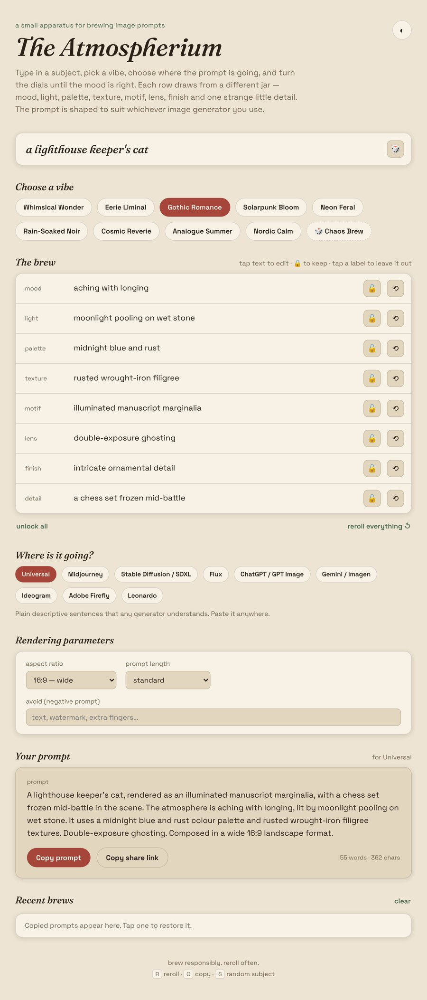
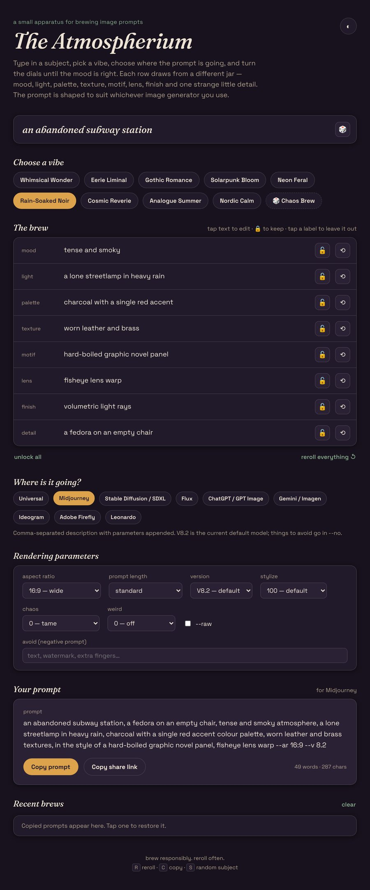
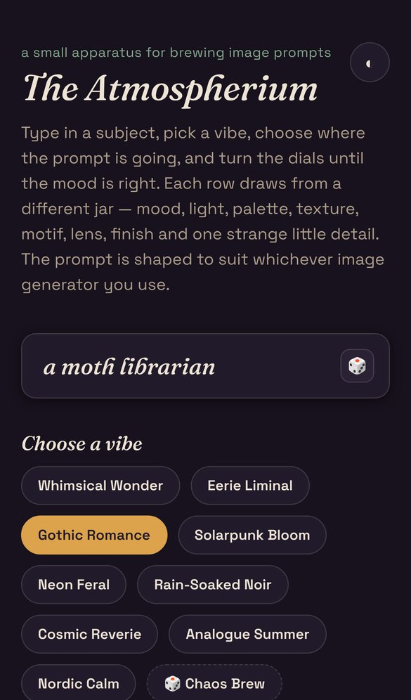

# 🔮 The Atmospherium

**A small apparatus for brewing atmospheric image prompts, and it works with any generator.**

### [▶ Live demo](https://yabbayabbayabba.github.io/atmospherium/)

Type a subject, pick a vibe, choose where the prompt is going, and reroll ingredients until the mood is right. The same brew is reshaped for each image model's preferred prompt style.

## Live demo

Try it in your browser at **https://yabbayabbayabba.github.io/atmospherium/**. There's nothing to install or sign up for, and it works on desktop and phone.

| Light theme: Gothic Romance, Universal | Dark theme: Rain-Soaked Noir, Midjourney |
|---|---|
|  |  |

<p align="center">
  
  <br><em>On iPhone</em>
</p>

## Supported targets

| Target | Prompt style | Negatives | Notes |
|---|---|---|---|
| Universal | Descriptive sentences | Inline "Avoid …" | Paste anywhere |
| Midjourney | Comma keywords + params | `--no` | `--ar`, `--stylize`, `--chaos`, `--weird`, `--raw`, `--v 8.2 / 8.1 / 7` |
| Stable Diffusion / SDXL | Weighted tags | Separate field | Subject weighting, quality tags, suggested SDXL resolution |
| Flux | Descriptive sentences | None (Flux ignores them) | |
| ChatGPT / GPT Image | Request in sentences | Inline | Aspect ratio stated in words |
| Gemini / Imagen | Request in sentences | Inline | Aspect ratio stated in words |
| Ideogram | Descriptive sentences | Separate field | Set the ratio in the toolbar |
| Adobe Firefly | Descriptive sentences | Inline | Set the ratio in the panel |
| Leonardo | Comma keywords | Separate field | Set dimensions in the sidebar |

## Features

- **9 vibes plus Chaos Brew:** Whimsical Wonder, Eerie Liminal, Gothic Romance, Solarpunk Bloom, Neon Feral, Rain-Soaked Noir, Cosmic Reverie, Analogue Summer, Nordic Calm
- **8 ingredient rows:** mood, light, palette, texture, motif, lens, finish and one odd detail
- Reroll one row or all of them, **lock** the rows you like, **edit** any phrase inline, or **leave a row out**
- Prompt length: short, standard or rich
- Random subject generator
- Copy the prompt and the negative prompt separately
- **Share links:** the whole brew is encoded in the URL
- **Recent brews:** the last 15 copied prompts, kept in your browser; tap one to restore it
- Light, dark or auto theme
- Keyboard shortcuts: `R` reroll · `C` copy · `S` random subject
- Works on phones. On iPhone, open it in Safari and choose Share → Add to Home Screen.

## Installation

The Atmospherium is a single self-contained `index.html`. It has no dependencies and no build step.

### Option 1: Run locally

```bash
git clone https://github.com/YabbaYabbaYabba/atmospherium.git
```

```bash
cd atmospherium
```

```bash
python3 -m http.server 8080
```

Then open <http://localhost:8080> in your browser. You can also just double-click `index.html` to open it straight from disk.

### Option 2: Host on GitHub Pages

1. Fork or push this repository to GitHub.
2. Go to **Settings → Pages**.
3. Under **Source**, pick **Deploy from a branch**. Select `main` and `/ (root)`, then click **Save**.
4. After a minute the app is live at `https://<your-username>.github.io/atmospherium/`.

### Option 3: Any other static host

Upload `index.html` to any static host (Netlify, Cloudflare Pages, Vercel, nginx, Apache and so on).

### Add to your phone's Home Screen

- **iPhone / iPad (Safari):** open the live demo, tap **Share**, then **Add to Home Screen**.
- **Android (Chrome):** open the live demo, tap the **⋮** menu, then **Add to Home screen**.

## Usage

1. Type a subject, or tap 🎲 (or press `S`) for a random one.
2. Pick a vibe. **Chaos Brew** mixes ingredients from every vibe.
3. Tweak the brew: tap a phrase to edit it, 🔒 to keep it, ⟲ to reroll it, or tap a row label to leave it out.
4. Choose where the prompt is going and set the rendering parameters (aspect ratio, length, negatives and model-specific options).
5. Click **Copy prompt** (or press `C`) and paste it into your generator. **Copy share link** saves the whole brew as a URL.

## Adding your own vibes

Add an entry to the `VIBES` object in `index.html` with the same six keys (`mood`, `lighting`, `palette`, `texture`, `motif`, `quirky`). The new vibe is picked up automatically, Chaos Brew included.

## Privacy

Everything runs in your browser. Your current brew, theme and recent brews are saved only in your browser's local storage. The only external request is for the Google Fonts the page uses.

## Contributors

- [@YabbaYabbaYabba](https://github.com/YabbaYabbaYabba): creator and maintainer

## Licence

[MIT](LICENSE)
